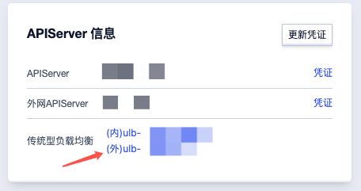
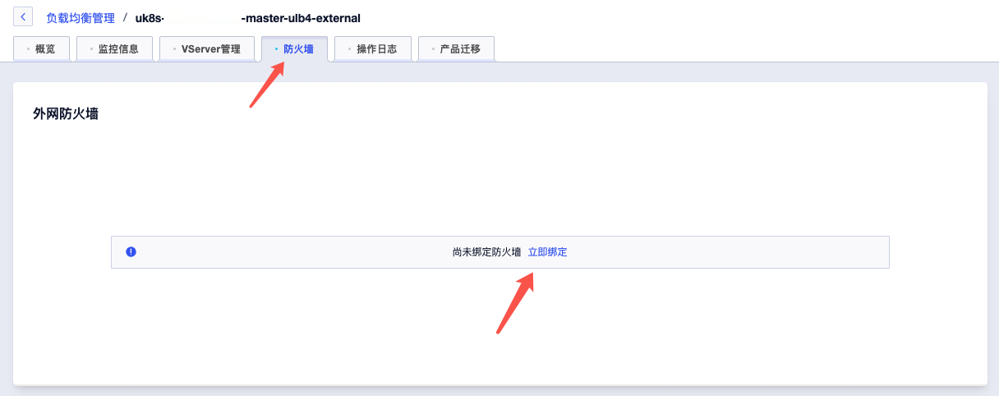
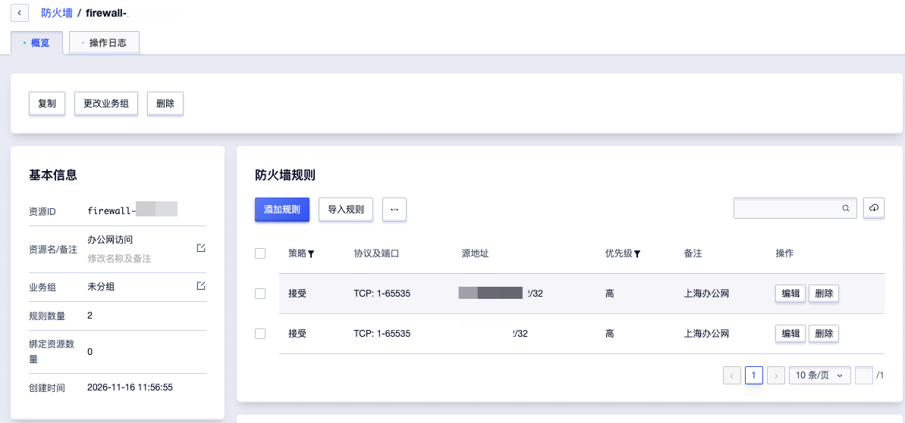

# 为外网 API Server 添加访问白名单

如果您开启了 API Server 的公网访问，我们强烈建议您对其开启访问控制以提升安全性。

## 操作步骤

以下以传统型负载均衡 CLB 作为 API Server 的前端代理的情况为例。如果您使用的是 NLB，操作页面提供的选项可能略有不同。

1. 在集群详情的「概览页」，定位到「APIServer 信息」。点击外部负载均衡的链接跳转到 ULB 控制台。

   

2. 在「负载均衡管理」的「防火墙」页面，点击「立即绑定」。

   

3. 将白名单 IP 按如下规则配置到防火墙后，绑定到负载均衡。

   

补充说明：

1. 绑定到负载均衡上的防火墙无需关注端口相关规则，可以全部放行。
2. 如果您使用的是安全组，也可以按类似的规则来配置。
